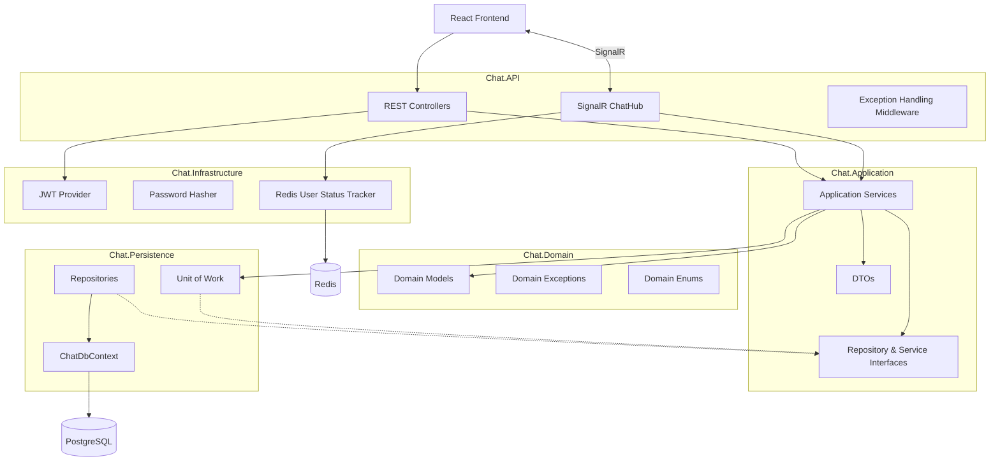

# Architecture 
## Overview
The application follows a layered backend architecture inspired by Clean Architecture principles. The backend is built with ASP.NET Core Web API and SignalR, while the frontend uses React.

The system separates HTTP communication, application logic, domain models, infrastructure integrations, and data persistence.


## Backend Architecture
### Chat.API
The presentation layer responsible for exposing application functionality through HTTP endpoints and SignalR.

**Responsibilities:**

* REST API controllers.
* SignalR Hub.
* Authentication and authorization integration.
* Exception handling middleware.
* Dependency injection configuration.
* HTTP request and response handling.

**Main components:**

* `Controllers/` - HTTP endpoints.
* `Hubs/ChatHub.cs` - real-time communication.
* `Middlewares/` - centralized exception handling.
* `Contracts/` - incoming request models.
* `Extensions/` - authentication configuration.

### Chat.Application
Contains application services, DTOs, and abstractions used by the application.

**Responsibilities:**

* Application use cases.
* Message and chat management.
* User-related operations.
* Repository abstractions.
* Coordination of persistence operations.

**Main components:**

* `Services/` - contains application services that implement business use cases, coordinate operations, and interact with repositories.
* `DTOs/` - defines Data Transfer Objects used to transfer data between application layers and expose structured responses to the API.
* `Interfaces/` - contains abstractions for repositories, services, and other dependencies required by the application layer.
  
### Chat.Domain
Contains the core domain models and business-related concepts.

**Responsibilities:**

* Domain entities and models.
* Domain exceptions.
* Message status definitions.
* Core business rules.

**Main components:**

* `Models/` - contains domain models and entities representing core application concepts, such as users, messages, chat rooms, and chat members.
* `Exceptions/` - defines custom domain exceptions used to represent business rule violations and domain-specific errors.
* `Enums/` - contains enumerations representing predefined values and states used throughout the domain, such as message statuses and other fixed classifications.

### Chat.Infrastructure

**Responsibilities:**

* JWT token generation.
* Password hashing.
* Redis-based user presence tracking.

**Main components:**

* `Authentication/` - contains authentication-related implementations, including JWT token generation and password hashing.
* `Services/RedisUserStatusTracker.cs` - implements user connection and online presence tracking using Redis.

### Chat.Persistence
Responsible for database access and persistence.

**Responsibilities:**

* Entity Framework Core configuration.
* Database context.
* Repository implementations.
* Database migrations.
* Unit of Work implementation.

**Main components**

* `ChatDbContext.cs` - defines the Entity Framework Core database context and provides access to database entities.
* `Entities/` - contains persistence entity classes representing data stored in the database.
* `Configurations/` - contains Entity Framework Core entity configurations, including relationships, constraints, and property mappings.
* `Repositories/` - contains repository implementations responsible for querying and modifying database records.
* `Migrations/` - stores database schema migration files generated by Entity Framework Core.
* `UnitOfWork.cs` - coordinates repository operations and manages saving changes to the database.

## Frontend Architecture
The frontend is built with React 19 and Vite. The project follows a feature-based structure, grouping components, hooks, services, and utilities according to application functionality.

The main application logic is organized around authentication and messenger features.
### Project Structure
The frontend source code is located in the `src/` directory.

**Main directories:**

* `api/` - contains modules responsible for communication with the backend REST API.
* `components/` - contains reusable UI components shared across the application.
* `features/` - contains feature-specific components, hooks, services, contexts, and utilities.
* `hooks/` - contains reusable React hooks shared across different parts of the application.
* `utils/` - contains general-purpose utility functions.
* `assets/` - stores static assets such as images and SVG files.

### Application Entry Point
**Main components:**

* `main.jsx` - initializes the React application and renders the root component.
* `App.jsx` - defines the main application component and application-level structure.
* `index.css` - contains global styles.

### Features
The `features/` directory contains the main application features.

**Authentication** 

Located in `features/auth/`.

**Main components:**

* `LoginPage.jsx` - provides the user login interface.
* `RegisterPage.jsx` - provides the user registration interface.

**Messenger**

Located in `features/messenger/`.

The messenger feature contains the main chat functionality and is divided into several subdirectories.

**Main components:**

* `components/` - contains UI components responsible for displaying chats, messages, the sidebar, modals, and other messenger elements.
* `constants/` - stores shared constants related to message statuses, message menu items, and sidebar menu items.
* `context/` - contains `MessengerContext`, which provides shared messenger state and functionality through React Context.
* `hooks/` - contains custom hooks responsible for chat operations, message handling, SignalR integration, sidebar behavior, context menus, and other interactive functionality.
* `mocks/` - contains mock chat data used during development or testing.
* `services/` - contains services responsible for external communication, including the SignalR chat hub service.
* `utils/` - contains helper functions for message formatting, chat sorting, reaction handling, and other messenger-related operations.

### API Communication
The `api/` directory contains modules responsible for communication with the backend REST API.

**Main components:**

* `apiFetch.js` - provides a shared HTTP request utility for communicating with the backend.
* `auth.js` - contains authentication-related API operations.

### Real-Time Communication
SignalR is used to provide real-time communication between the frontend and backend.

**Main components:**

* `features/messenger/services/chatHub.js` - contains the SignalR connection service.
* `features/messenger/hooks/chat/useChatHub.js` - provides a React hook for integrating SignalR functionality into the messenger feature.

The SignalR integration supports real-time messaging, message reactions, read receipts, typing indicators, message deletion, pinned messages, and user presence updates.

See [Real-Time Communication](realtime.md) for more details.

### State Management
The application uses React Context and custom hooks to organize and share application state.

**Main components:**
* `features/messenger/context/MessengerContext.jsx` - provides shared messenger state and functionality.
* `features/messenger/hooks/` - contains custom hooks responsible for managing chat-related operations and UI behavior.

## Backend Infrastructure
### Dependency injection
Application dependencies are registered in `Program.cs`.

|**Component**|**Lifetime**|
|---|---|
|ChatDbContext|Scoped|
|Repository implementations|Scoped|
|UnitOfWork|Scoped|
|Application services|Scoped|
|JWT Provider|Scoped|
|Password Hasher|Scoped|
|IConnectionMultiplexer|Singleton|
|IUserStatusTracker|Singleton|

### Data Storage
**PostgreSQL**

PostgreSQL is the primary relational database.

Entity Framework Core with the Npgsql provider is used for database access and schema management.

**Redis**

Redis is used by RedisUserStatusTracker to track user connections and online presence.

The connection multiplexer is registered as a singleton.

### Real-Time Communication
SignalR provides real-time communication between connected clients.

The Hub is mapped to:
```CSharp
/chatHub
```
It handles:
* Message delivery.
* Message reactions.
* Read receipts.
* Typing indicators.
* Message deletion events.
* Pinned message updates.
* User presence notifications.

See [Real-Time Communication](realtime.md) for details.

### Authentication
The application uses JWT authentication for protected API endpoints and SignalR connections.

Refresh tokens are stored in HTTP-only cookies and managed through authentication endpoints.

See [Authentication](authentication.md) for details.

### Error Handling
The API pipeline includes a centralized ExceptionHandlingMiddleware for handling application exceptions.

### Configuration
Application configuration is loaded through ASP.NET Core configuration providers.

Database connection strings and JWT settings are accessed through application configuration.

Sensitive configuration values should be provided through environment variables or other secure configuration mechanisms.
